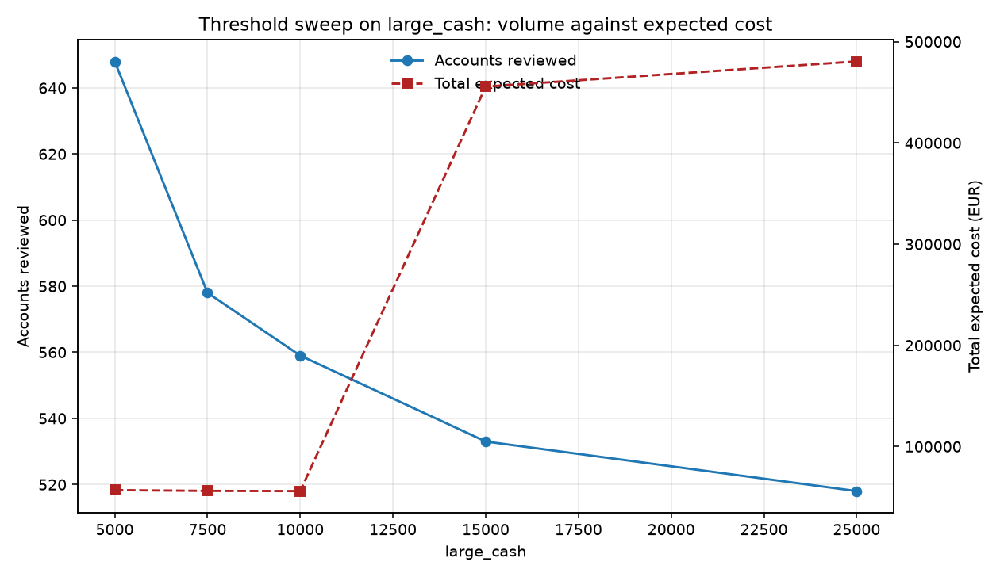

# Transaction monitoring - rule performance and threshold tuning

Generated 2026-10-17 by `python -m aml.run_pipeline --sweep large_cash`.

Synthetic book: 2,000 accounts, 488,516 transactions, 180 business days, seed 20260101. Base rate of suspicious accounts 2.80%.

Cost assumptions, all arguable and all adjustable on the command line: 20 minutes to triage one alert at EUR 32/hour (EUR 10.67 per alert); EUR 25,000 for a missed reportable case; EUR 250,000 for a missed sanctions hit, because that one is strict liability.

## Per-rule performance

Recall (all) scores each rule against every suspicious account, including typologies it was never written to catch. Recall (own typology) is the number that means something.

| Rule | Alerts | TP | FP | Precision | Recall (all) | Recall (own typology) | Target pop. | Alerts per true case |
| --- | --- | --- | --- | --- | --- | --- | --- | --- |
| large_cash | 488 | 21 | 467 | 4.3% | 37.5% | 53.1% | 32 | 23.24 |
| structuring | 22 | 20 | 2 | 90.9% | 35.7% | 100.0% | 20 | 1.10 |
| pass_through | 473 | 24 | 449 | 5.1% | 42.9% | 87.5% | 16 | 19.71 |
| dormant_reactivation | 0 | 0 | 0 | n/a | 0.0% | 0.0% | 12 | inf |
| sanctions_screening | 8 | 8 | 0 | 100.0% | 14.3% | 100.0% | 8 | 1.00 |

## The queue an analyst actually faces

De-duplicated to accounts, so a customer caught by three rules counts once.

| Measure | Value |
| --- | --- |
| Accounts reviewed | 559 |
| raw_alert_rows | 991 |
| duplicate_alert_rows | 432 |
| TP | 54 |
| FP | 505 |
| FN | 2 |
| Precision | 9.7% |
| Recall (all) | 96.4% |
| FP rate | 26.0% |
| Alerts per true case | 10.35 |
| Missed sanctions | 0 |
| Analyst hours | 186.33 |
| FP cost | EUR 5,387 |
| Missed-case cost | EUR 50,000 |
| Total expected cost | EUR 55,963 |

## What the rule set missed

| Typology | Population | Detected | Missed | Detection rate |
| --- | --- | --- | --- | --- |
| pass_through | 16 | 14 | 2 | 87.5% |
| dormant | 12 | 12 | 0 | 100.0% |
| sanctions | 8 | 8 | 0 | 100.0% |
| structuring | 20 | 20 | 0 | 100.0% |

## Threshold sweep on `large_cash`

Every row is a full re-run of the rule set. Tightening a threshold always buys fewer alerts and always buys fewer detections; the only question is the exchange rate between analyst hours and missed reports.

| large_cash | Accounts reviewed | TP | FP | FN | Precision | Recall (all) | Missed sanctions | Analyst hours | FP cost | Missed-case cost | Total expected cost |
| --- | --- | --- | --- | --- | --- | --- | --- | --- | --- | --- | --- |
| 5,000 | 648 | 54 | 594 | 2 | 8.3% | 96.4% | 0 | 216.00 | EUR 6,336 | EUR 50,000 | EUR 56,912 |
| 7,500 | 578 | 54 | 524 | 2 | 9.3% | 96.4% | 0 | 192.67 | EUR 5,589 | EUR 50,000 | EUR 56,165 |
| 10,000 | 559 | 54 | 505 | 2 | 9.7% | 96.4% | 0 | 186.33 | EUR 5,387 | EUR 50,000 | EUR 55,963 |
| 15,000 | 533 | 38 | 495 | 18 | 7.1% | 67.9% | 0 | 177.67 | EUR 5,280 | EUR 450,000 | EUR 455,685 |
| 25,000 | 518 | 37 | 481 | 19 | 7.1% | 66.1% | 0 | 172.67 | EUR 5,131 | EUR 475,000 | EUR 480,525 |

### Reading the sweep

On these cost assumptions the cheapest setting of `large_cash` is **10000.0**, at EUR 55,963 total expected cost: 559 accounts reviewed, 2 suspicious accounts missed, 0 of them sanctions cases. That is a defensible recommendation only because the assumptions behind it are written down above - change the price of a missed case and the recommendation moves, which is exactly the argument to have with a compliance officer rather than hide inside a model.

### The limitation that matters most

Recall here is measurable only because the data is synthetic and the typologies were injected deliberately. On a real book nobody knows the denominator: you can measure the cases you found and never the ones you did not. Every recall figure above should be read as *recall against known injected typologies*, which is an upper bound on what the same rules would achieve against an adversary who is adapting to them.

